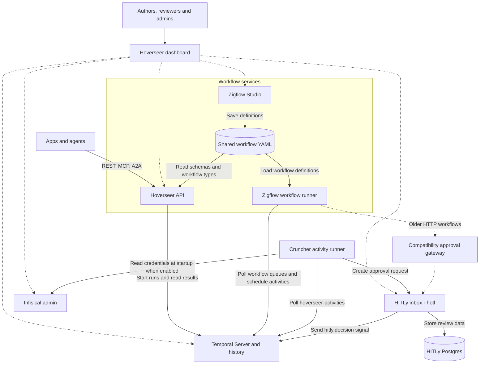

# hoverseer

Hoverseer runs workflows with human approval. Author workflows in Zigflow Studio, run them on Temporal, and review approval requests in HITLy. The included workflows demonstrate refund decisions and editorial approval.

The sample workflow automatically approves up to **$100.00**. Larger amounts create an inbox item and wait up to five minutes for a reviewer. HITLy sends a Temporal signal with the decision. Zigflow returns `approved` or `rejected`. A missed deadline fails the execution with a timeout.

## Architecture

| Container | Type | Purpose |
| --- | --- | --- |
| `dashboard` | Management dashboard | Homepage launchpad for Studio, HITLy, Temporal Web, OpenAPI and Infisical on `8082`. |
| `api` | API server | Exposes managed workflows through REST, MCP, A2A, and OpenAPI on `8081`. |
| `studio` | Authoring server | Edits the shared Zigflow YAML on `3000`. |
| `temporal` | Orchestration server | Persists workflow history, timers, and signals. Serves Temporal clients on `7233` and Temporal Web on `8233`. |
| `hotl` | Review server | Runs the HITLy inbox on `3001` and sends reviewer decisions to Temporal. |
| `postgres` | Database server | Stores HITLy inbox and project data. |
| `zigflow` | Workflow runner | Loads the YAML and polls the workflow task queues. Handles control flow and approval waits. |
| `cruncher` | Activity runner | Polls `hoverseer-activities` and runs named activities. `requestApproval` calls HITLy using Cruncher's credentials. |
| `approval-gateway` | Compatibility server | Accepts approval requests from older saved workflows that still use HTTP. |

Docker Compose runs nine long-running containers during migration and eight after the compatibility gateway is retired. On Kubernetes, API, Studio and Zigflow share the `workflow` pod and YAML volume. The dashboard, Cruncher, Temporal, HITLy, Postgres and compatibility gateway each have their own deployment. Infisical runs separately if enabled.



## Repository layout

| Path | Contents |
| --- | --- |
| `api/` | REST, MCP and A2A workflow endpoints |
| `cruncher/` | Activity worker and reusable steps |
| `gateway/` | Compatibility gateway for older approval workflows |
| `integrations/` | Integration clients shared by services |
| `workflows/` | Bundled workflows and their public catalog |
| `deploy/` | Dockerfiles, Kubernetes manifests, dashboard settings and workflow seeding |

The root `compose.yaml`, `kustomization.yaml` and `./hoverseer` are deployment entry points. Kustomize resolves the workflow files and shared source from the repository root.

## Choose a deployment

Both deployments run Zigflow for workflow orchestration and `cruncher` for Temporal activities. Zigflow loads every project saved as `workflows/<project>/workflow.yaml` in the shared volume. Cruncher polls `hoverseer-activities` and registers `requestApproval`. It calls the HITLy service at `hotl:3001` using its own credentials. Both runners connect to the same Temporal namespace.

Prerequisites are Bash, OpenSSL, Docker with Compose v2.24 or later for the Docker path, or a Kubernetes cluster with a default storage class and `kubectl` for the Kubernetes path. The example below uses kind and Docker to build the two upstream app images. First builds download the pinned upstream source and dependencies.

### Docker Compose

```bash
./hoverseer init
./hoverseer docker up
```

Check startup with `docker compose ps`. HITLy runs its database migrations at startup. Shut down with `./hoverseer docker stop`.

### Kubernetes

This example assumes a new or existing kind cluster named `hoverseer`.

```bash
kind create cluster --name hoverseer
kubectl config use-context kind-hoverseer
./hoverseer init
./hoverseer kubernetes build
kind load docker-image hoverseer-studio:local hoverseer-hitly:local hoverseer-api:local hoverseer-cruncher:local --name hoverseer
./hoverseer kubernetes up
./hoverseer kubernetes forward
```

Keep port forwarding running in a separate terminal. Check startup with `kubectl -n hoverseer get pods,pvc`. On another Kubernetes cluster, publish the four images to a registry the cluster can pull from, set the corresponding image names in a Kustomize overlay or in `deploy/kubernetes/stack.yaml`, and run `./hoverseer kubernetes up` using that context. Use only one deployment on the same set of local ports at a time.

### Open the apps

Start at **[Hoverseer on localhost:8082](http://localhost:8082)**. Homepage groups the management tools and shows HTTP reachability for the local services. Each tool handles its own access. The dashboard is local by default and requires no access to Docker, the Kubernetes API or Infisical credentials.

| App | Local URL | Use |
| --- | --- | --- |
| Hoverseer dashboard | [localhost:8082](http://localhost:8082) | Open management tools |
| Zigflow Studio | [localhost:3000](http://localhost:3000) | Create or edit workflow projects |
| HITLy (`hotl`) | [localhost:3001](http://localhost:3001) | Review requests and record decisions |
| Temporal Web | [localhost:8233](http://localhost:8233) | Inspect workflow status, event history and results |
| Workflow API | [localhost:8081/openapi.json](http://localhost:8081/openapi.json) | Discover managed workflow routes |
| Infisical | [localhost:8084](http://localhost:8084) or configured URL | Manage credentials on a separate Infisical instance |

For Docker, configure the dashboard port and allowed hosts via `HOVERSEER_DASHBOARD_PORT` and `HOVERSEER_DASHBOARD_HOSTS`. Set `HOVERSEER_STUDIO_URL`, `HOVERSEER_HOTL_URL`, `HOVERSEER_TEMPORAL_WEB_URL`, `HOVERSEER_API_DOCS_URL` and `HOVERSEER_INFISICAL_UI_URL` as needed for browser-reachable links. For Kubernetes, patch the corresponding `HOMEPAGE_ALLOWED_HOSTS` and `HOMEPAGE_VAR_*` settings in the dashboard Deployment. Configure [Homepage authentication](https://gethomepage.dev/installation/#security-authentication) or an authenticated reverse proxy before publishing the dashboard.

## Connect the inbox

1. Create a local HITLy account and a project using the **Temporal** plugin.
2. In the project's configuration, use `temporal:7233` for **Temporal address** and **Workflow address**, and `default` for **Temporal namespace**. Use `refund-review` if the interface asks for the task queue. No Temporal API key is needed for this local server.
3. Create a project API key. Place the project ID and API key in Infisical as described below or use `HITLY_PROJECT_ID` and `HITLY_API_KEY` in `.env`. Keep the generated database and authentication settings in `.env`.
4. Run `./hoverseer docker configure` or `./hoverseer kubernetes configure`. This reloads the HITLy credentials in Cruncher and the compatibility gateway. If HITLy offers a project SLA setting, set it close to the five-minute workflow wait. The Temporal deadline and HITLy inbox expiry are separate.

### Use Infisical for Cruncher

1. Use an existing Infisical instance or deploy one with the official [Compose setup](https://infisical.com/docs/self-hosting/deployment-options/docker-compose) or [Helm chart](https://infisical.com/docs/self-hosting/deployment-options/kubernetes-helm). Set the dashboard's Infisical link to the URL admins use in their browsers.
2. In Infisical, create a project, an environment such as `prod`, and a folder such as `/cruncher`. Save `HITLY_PROJECT_ID` and `HITLY_API_KEY` there. Give a [Universal Auth machine identity](https://infisical.com/docs/documentation/platform/identities/universal-auth) permission to read secrets in that environment and folder.
3. Create `cruncher/.env.infisical` with permissions `0600` for Docker. The file is ignored by Git. For Kubernetes, use the same keys in the `hoverseer-infisical` Secret. The SDK URL must be reachable from Cruncher. Use HTTPS for a remote instance.

   ```dotenv
   INFISICAL_SITE_URL=https://infisical.example.com
   INFISICAL_PROJECT_ID=<infisical-project-id>
   INFISICAL_CLIENT_ID=<machine-identity-client-id>
   INFISICAL_CLIENT_SECRET=<machine-identity-client-secret>
   INFISICAL_ENVIRONMENT=prod
   INFISICAL_SECRET_PATH=/cruncher
   ```

   With the Kubernetes namespace already created, you can apply the file as follows.

   ```bash
   kubectl -n hoverseer create secret generic hoverseer-infisical \
     --from-env-file=cruncher/.env.infisical --dry-run=client -o yaml |
     kubectl apply --server-side -f -
   ```

4. Run `docker compose up -d --no-deps --force-recreate cruncher` or `kubectl -n hoverseer rollout restart deployment/cruncher` to pick up the settings and after changing either HITLy secret. Cruncher reads both keys before it starts polling Temporal. Authentication or lookup failures stop worker startup. The compatibility gateway still uses `.env` for any legacy workflows that call it.

## Run a workflow

Use the workflow type as the first argument and pass its input as JSON. The task queue defaults to the workflow type. If `document.taskQueue` is different, specify it with `--task-queue`.

```bash
./hoverseer docker start articleReview '{"headline":"Release notes","draft":"What changed this week."}'
./hoverseer kubernetes start articleReview '{"headline":"Release notes","draft":"What changed this week."}'
./hoverseer docker start refundReview '{"orderId":"order-123","amountCents":15000}' --task-queue refund-review
```

In HITLy, open the article review and approve it to return `ready_to_publish` or reject it to return `changes_requested`. See the result in Temporal Web.

### Refund example

Use the backend you started. These commands show Docker.

```bash
./hoverseer docker start 5000 order-small
./hoverseer docker start 15000 order-approve
./hoverseer docker start 15000 order-reject
```

For Kubernetes, use `./hoverseer kubernetes start` with the same arguments.

- Open the first run in Temporal Web. Its output is `auto_approved`. It creates no inbox item.
- Approve the second request in HITLy. The same Temporal execution returns `approved`. Reject the third request to get `rejected`.
- For a timeout, start another large refund and let the five-minute wait elapse. If the HITLy item remains visible, it expires independently or can be cancelled from HITLy.
- To verify recovery, start a large refund, leave it pending, and run `./hoverseer docker reload` or `./hoverseer kubernetes reload` before approving. Restart port forwarding after the Kubernetes reload if it ends.

## Manage workflows for HTTP callers

The [managed workflow catalog](workflows/catalog.yaml) maps each public name to a Studio project directory. The refund and article approval projects are listed. Add another entry after creating or importing its project. Zigflow still loads the saved YAML from the shared volume. The API reads the target workflow type, task queue and input schema from that same file. Projects outside the catalog remain available through Studio and the CLI.

Run `./hoverseer docker reload` after changing a catalog entry or a saved workflow. After upgrading from a checkout that stored the catalog in `deploy/`, run `./hoverseer docker up` once to recreate the API container with the new mount. On Kubernetes, use `./hoverseer kubernetes up` after changing the catalog and `./hoverseer kubernetes reload` after changing a saved workflow. If upgrading from an older checkout, run `./hoverseer init` and bring up the stack to add the API and its token while retaining your existing credentials.

### Discover and call a workflow

| Endpoint | Purpose |
| --- | --- |
| `GET /openapi.json` | OpenAPI 3.1 document with one start operation and its Zigflow input schema per managed workflow |
| `GET /v1/workflows` | Managed workflow names and start URLs |
| `POST /v1/workflows/{name}/runs` | Start a named workflow with a JSON body and return `202 Accepted` and a URL to check its status |
| `GET /v1/runs/{workflowId}` | Read the execution status and the result when it completes |

Discovery is public. Start and status requests require the bearer token in `.env`. The API accepts valid JSON and Zigflow enforces the workflow's input schema during execution.

```bash
token=$(sed -n 's/^HOVERSEER_API_TOKEN=//p' .env)
curl -i http://localhost:8081/v1/workflows/article-review/runs \
  -H "Authorization: Bearer $token" \
  -H 'Content-Type: application/json' \
  -H 'Idempotency-Key: release-notes-2026-11-21' \
  --data '{"headline":"Release notes","draft":"What changed this week."}'
```

Call the returned `Location` URL with the same bearer token. A run waiting for a HITLy decision remains `RUNNING`. Retrying the same workflow with the same idempotency key and input returns the existing execution for as long as Temporal retains it. Reusing the key with different input returns `409 Conflict`.

For remote callers, route HTTPS through a reverse proxy to the Compose API port or through an Ingress to the Kubernetes Service `api:8081`. The API binds to loopback through Compose and uses a ClusterIP Service in Kubernetes. Keep the approval gateway internal. Its own OpenAPI document is available at `http://approval-gateway:8080/openapi.json` from within the stack.

### Call workflows through MCP or A2A

MCP tools and A2A skills use the same managed catalog and Temporal runs as the HTTP API. A run started through one interface can be read through another using its workflow ID.

| Interface | Discovery | Call and follow |
| --- | --- | --- |
| MCP | Connect to `/mcp` using Streamable HTTP and list tools. | Call a tool such as `start_article_review` with the advertised Zigflow input. Read the run through `get_run`. |
| A2A 1.0 HTTP+JSON | Read `/.well-known/agent-card.json` to discover the endpoint and its skills. | Send a data part with `workflow` and `input`, then get the resulting task and its output artifact. |

Configure the same `Authorization: Bearer <token>` header as the workflow HTTP API. MCP clients must support setting a bearer header for this deployment. For public deployments, set `HOVERSEER_PUBLIC_URL` to the HTTPS origin callers use. The Agent Card advertises this origin and the MCP endpoint checks it alongside the local hostnames. The reverse proxy should preserve the original Host header.

An MCP caller can supply an `Idempotency-Key` header on a start call. An A2A caller can retry the same message ID with the same input to recover the existing task. Each interface returns the same Temporal workflow ID for the same execution.

```bash
curl http://localhost:8081/a2a/message:send \
  -H "Authorization: Bearer $token" \
  -H 'A2A-Version: 1.0' \
  -H 'Content-Type: application/json' \
  --data '{
    "message": {
      "messageId": "article-review-1",
      "role": "ROLE_USER",
      "parts": [{"data": {
        "workflow": "article-review",
        "input": {"headline": "Release notes", "draft": "What changed this week."}
      }}]
    },
    "configuration": {"returnImmediately": true}
  }'
```

Set `returnImmediately` for workflows that wait on a reviewer. Poll `GET /a2a/tasks/{id}` with the same version and auth headers until the task finishes. `POST /a2a/tasks/{id}:cancel` requests cancellation in Temporal. An existing HITLy item can still expire or be closed in its inbox. OpenAPI documents the transport endpoints, and the respective protocol provides tool or skill discovery.

### Components

- Zigflow already loads, validates, and executes multiple YAML definitions. [Zigflow CLI](https://zigflow.dev/docs/cli/using-the-cli/)
- Temporal already owns starting, describing, and deduplicating executions. Hoverseer uses the official TypeScript SDK. Temporal also defines a lower-level HTTP mapping, which exposes Temporal's own workflow service contract. [Temporal API](https://docs.temporal.io/self-hosted-guide/server-frontend-api-reference) · [HTTP protocol mappings](https://github.com/temporalio/api/blob/main/temporal/api/workflowservice/v1/service.proto)
- The official A2A JavaScript SDK handles A2A HTTP+JSON, and the official MCP TypeScript SDK serves Streamable HTTP with Fastify. Both use the same Temporal run service. [A2A JavaScript SDK](https://github.com/a2aproject/a2a-js) · [MCP Fastify guide](https://ts.sdk.modelcontextprotocol.io/v2/serving/fastify.html)
- Fastify and its Swagger plugin generate the OpenAPI document from the registered routes. Hono's Zod OpenAPI integration is another option. Using Fastify here lets us publish the JSON Schema already stored in Zigflow YAML. [Fastify Swagger](https://github.com/fastify/fastify-swagger) · [Hono Zod OpenAPI](https://hono.dev/examples/zod-openapi)

## Add or edit a workflow

Create a project in Studio or import an existing Zigflow YAML file. Import validates the file and creates a new Studio project. Use Studio to update an existing project.

```bash
./hoverseer docker import my-workflow path/to/workflow.yaml
./hoverseer docker reload
```

Use the same commands with `kubernetes` on that backend. Reload registers the saved definitions with Zigflow. Let active runs finish before reloading a changed definition, since a new definition can change how Temporal replays those runs. The seed step preserves existing Studio edits across restarts.

### Add a human approval

Use Zigflow’s `call: activity` task to send a request to Cruncher.

```yaml
- requestReview:
    call: activity
    with:
      name: requestApproval
      taskQueue: hoverseer-activities
      arguments:
        - title: Review article draft
          context: Approve the draft to mark it ready for publication.
          payload:
            headline: '${ $input.headline }'
```

The activity takes a title, optional Markdown context, and an optional JSON object for the review details. It returns an `approvalId`. Cruncher gets the workflow execution identifiers from Temporal and uses the activity ID to send a stable idempotency key on retries. Additional named activities can register with the same worker and queue.

Add a `listen` task in the main workflow for `hitly.decision`. The workflow owns the timeout and the branches for `accept` or `reject`. See the [article workflow](workflows/article-review/workflow.yaml) and the [refund workflow](workflows/refund-review/workflow.yaml) for complete examples.

### Run a multiline shell step

Use a YAML literal block (`|`) to write multiple commands, like a GitHub Actions `run` block. Hoverseer uses Zigflow's built-in [shell task](https://zigflow.dev/docs/dsl/tasks/run/#shell) for this step.

```yaml
- runShell:
    run:
      shell:
        command: /bin/sh
        arguments:
          - -c
          - |
            set -eu
            printf '%s\n' 'Running shell step'
            printf 'Message: %s\n' "$MESSAGE"
        environment:
          MESSAGE: '${ $input.message }'
```

Configure the executable, arguments and environment in the workflow. Pass caller values through environment variables and quote them in the script so the shell treats them as data. Zigflow runs the command inside its worker container with the worker's permissions and environment. A successful step returns stdout. A nonzero exit fails the activity.

The [bundled shell example](workflows/shell-example/workflow.yaml) sets a ten-second activity timeout and one attempt. Open it in Studio to edit the script. Start it with the CLI and inspect the result in Temporal Web.

```bash
./hoverseer docker start shellExample '{"message":"Hello from Hoverseer"}'
./hoverseer kubernetes start shellExample '{"message":"Hello from Hoverseer"}'
```

### Add a Cruncher step

Use [request approval](cruncher/steps/request-approval/) as a template. Put the implementation in `activity.mjs`, its tests in `activity.test.mjs`, and the step ID, Temporal activity name, label, and input schema in `step.json`. The schema describes the input for tooling. The activity validates its arguments at runtime.

Register the step in [Cruncher's activity registry](cruncher/steps/index.mjs) and rebuild Cruncher. Workflows invoke the registered name through `call: activity` on `hoverseer-activities`. Keep the registered names and input contracts compatible with saved workflows. Integration clients shared by multiple services live under `integrations/`.

### Upgrade existing deployments

- For Docker, stop or bring down the previous Compose stack before starting the renamed `hotl` service so both containers do not claim port `3001`. Keep the existing volumes. The database name, credentials, and HITLy volume are reused. On Kubernetes, the existing HITLy Deployment is updated in place and exposed by the new `hotl` Service.
- Seeding preserves workflow files already on the shared volume. The compatibility gateway stays available for those definitions. After their active runs finish, update their review steps to the example above and reload Zigflow. Keep the gateway running while any definitions still use its HTTP endpoint.

Open Studio and Temporal Web on localhost through Compose or kubectl port forwarding.
