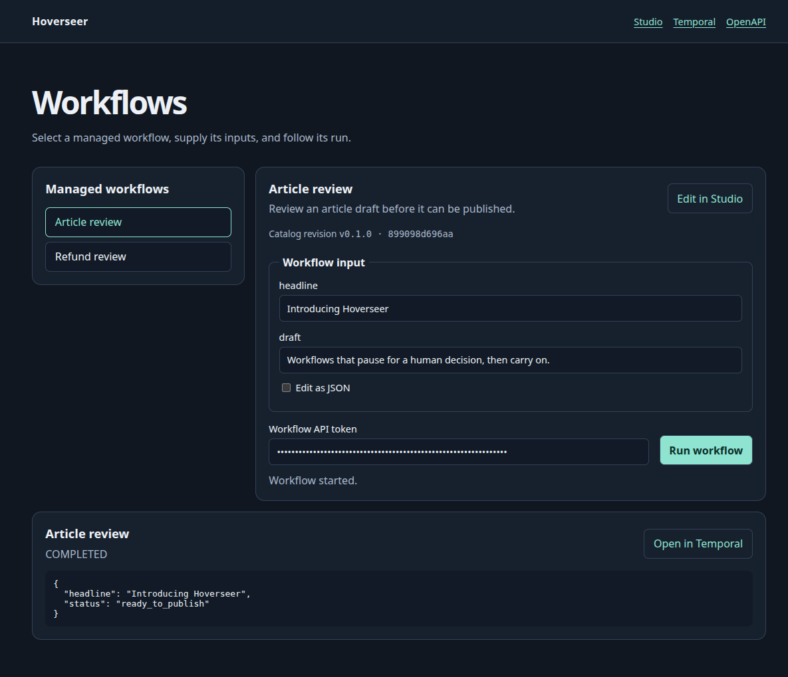
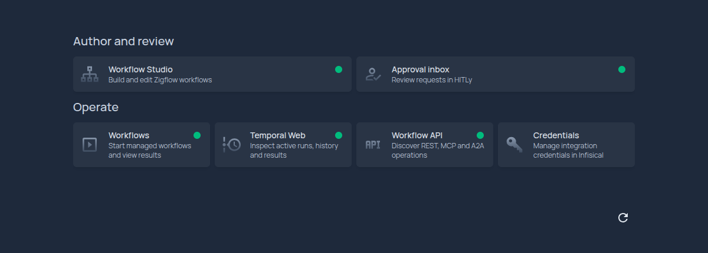
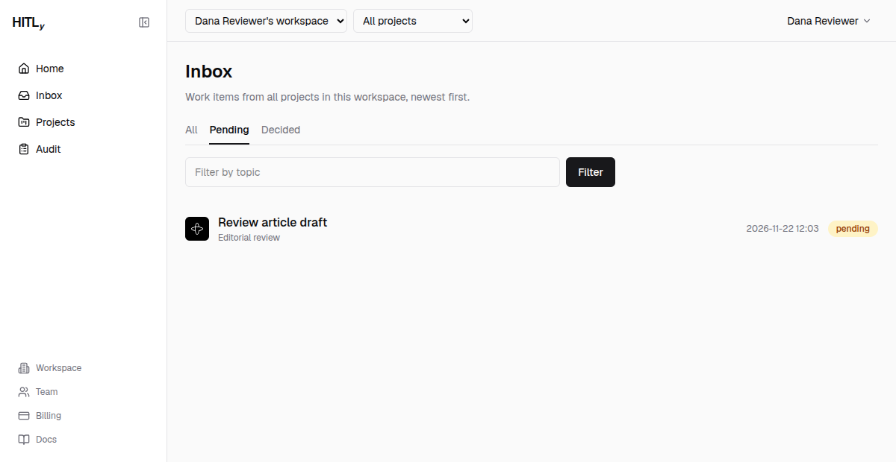
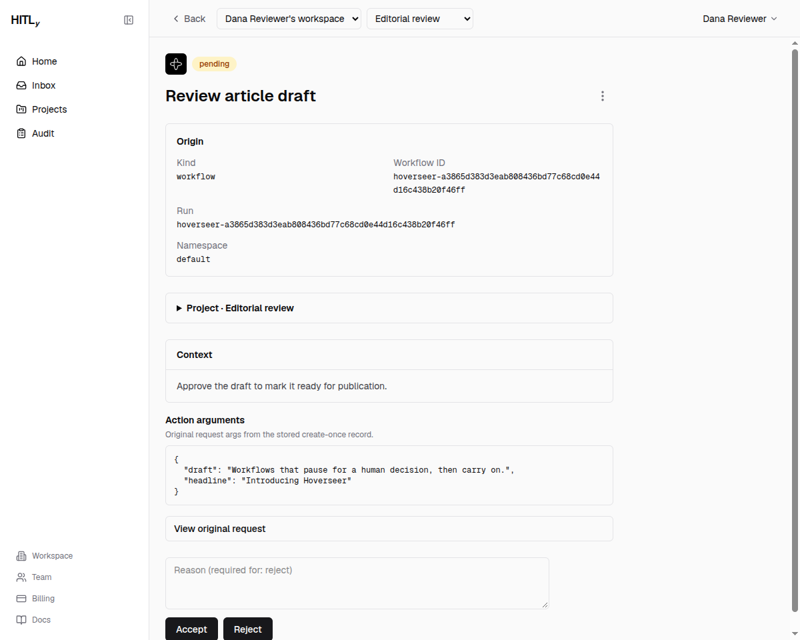
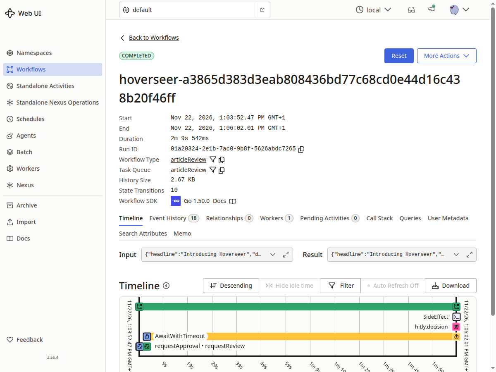
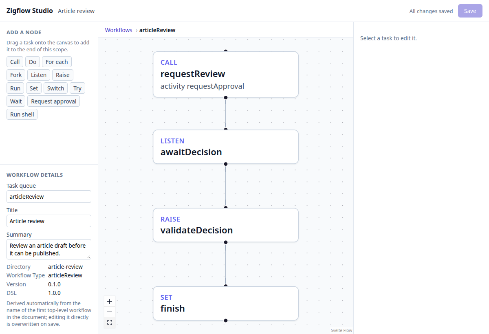
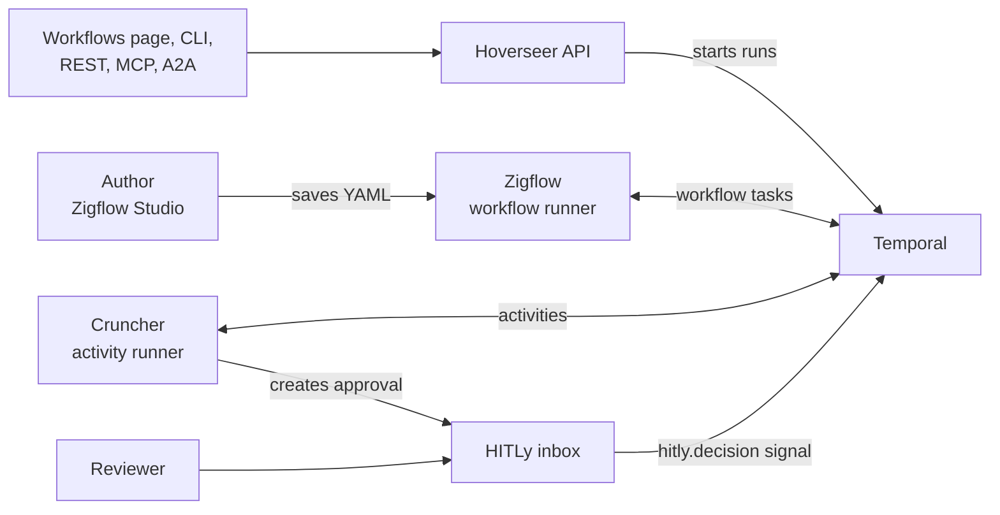
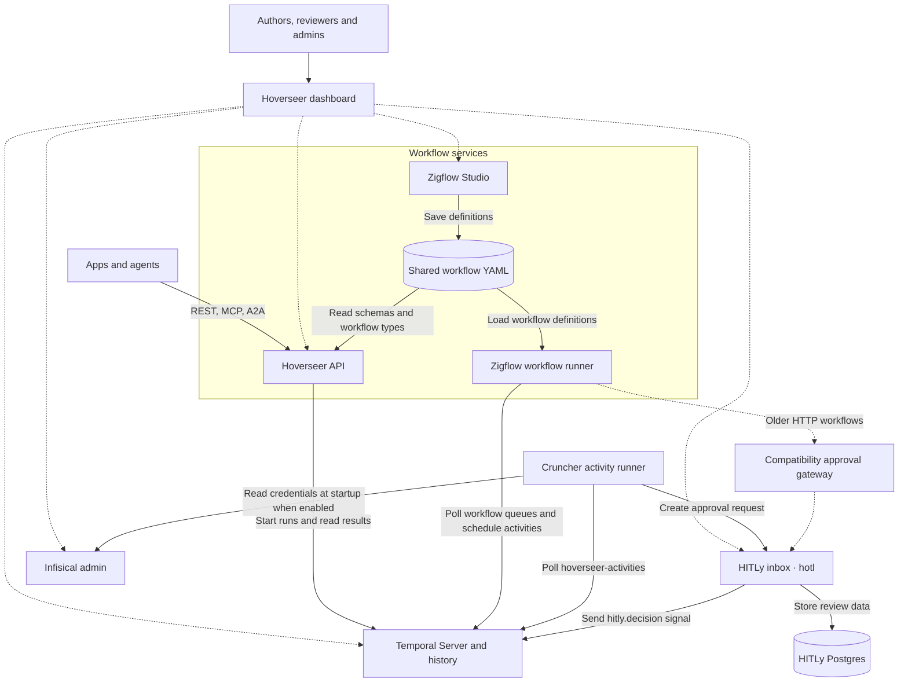

# Hoverseer

**Run workflows that pause for a human decision, then carry on.**

[](LICENSE)
[](https://github.com/tbrandenburg/hoverseer/actions/workflows/checks.yml)

[Quick start](#quick-start) · [Tour](#tour) · [How it works](#how-it-works) · [Documentation](#documentation) · [Contributing](CONTRIBUTING.md)



Hoverseer puts [Zigflow](https://github.com/zigflow/zigflow), [Temporal](https://temporal.io) and [HITLy](https://github.com/hitly-net/hitly) in one self-hosted stack, with a small API and an activity worker. You write a workflow in YAML or draw it in [Zigflow Studio](https://github.com/zigflow/studio), and Temporal runs it durably. When a step needs a person, an approval request appears in the HITLy inbox. The reviewer's decision returns to the same run as a Temporal signal, and the workflow continues.

You can start workflows from a web page, the command line, REST, MCP or A2A, so people, apps and agents can all use the same approvals.

## Status

- Docker Compose is the quickest way to run Hoverseer. Kubernetes manifests are included and described in the [deployment guide](docs/DEPLOYMENT.md).
- Zigflow is pre-1.0 and pinned to `0.18.1`. Its maintainers say backwards-incompatible changes may still occur before v1.0.
- Zigflow Studio is a work in progress and is treated here as an authoring convenience. Workflows are standard Zigflow YAML, and stock Zigflow runs them.
- Shell steps run with the same user, filesystem and network as the approval worker. Use them only with trusted workflow authors.
- The dashboard has no authentication of its own and listens on localhost by default. Add authentication or an authenticated proxy before publishing it. The API requires a bearer token to start runs and read their status.

## Features

| | |
| --- | --- |
| **Human approval built in** | The `requestApproval` step creates an inbox item. A reviewer accepts or rejects it, and the run resumes with the decision. |
| **Durable by default** | Temporal stores history, timers and signals, so a run that waits for a reviewer is a normal, inspectable execution. |
| **Author in YAML or visually** | Studio edits plain Zigflow YAML and adds **Request approval** and **Run shell** to its palette. |
| **Start from anywhere** | The Workflows page, the `./hoverseer` CLI, REST with OpenAPI, MCP tools and A2A skills share one catalog and the same runs. |
| **Shell steps** | Run multi-line scripts that share a working directory across the steps of one run. |
| **Self-hosted** | Docker Compose or Kubernetes with Kustomize. No external service is required; Infisical for credentials is optional. |

## Quick start

You need Bash, OpenSSL, Docker and Docker Compose v2.24 or later. Ports `3000`, `3001`, `8081`, `8082` and `8233` must be free on `localhost`.

```bash
git clone https://github.com/tbrandenburg/hoverseer
cd hoverseer
./hoverseer init          # creates .env with generated secrets
./hoverseer docker up     # first build downloads the pinned upstream sources
```

Open **[localhost:8082](http://localhost:8082)** for the dashboard, then run a workflow that needs no reviewer:

```bash
./hoverseer docker start 5000 order-small
```

The refund workflow approves amounts up to $100.00 automatically. Open the run in [Temporal Web](http://localhost:8233) to see the result `auto_approved`.

### Try an approval

Larger amounts, and the article review, wait for a person. Connect the inbox once:

1. Open [HITLy](http://localhost:3001), create a local account, and create a project using the **Temporal** plugin.
2. In the project's configuration, set **Temporal address** and **Workflow address** to `temporal:7233`, the namespace to `default`, and the task queue to `articleReview`.
3. Create a project API key. Put the project ID and key in `.env` as `HITLY_PROJECT_ID` and `HITLY_API_KEY`.
4. Run `./hoverseer docker configure`.

Then start the article review from the Workflows page, as shown in the tour below, or from the command line:

```bash
./hoverseer docker start articleReview '{"headline":"Release notes","draft":"What changed this week."}'
```

Details, Kubernetes and credential management with Infisical are in the [deployment guide](docs/DEPLOYMENT.md).

## Tour

This walkthrough follows one article review from start to finish.

### 1. Start at the dashboard

The dashboard at `localhost:8082` links to every tool and shows whether each service is reachable.



### 2. Run a workflow

Open **Workflows**, pick **Article review**, fill in the form that is generated from the workflow's input schema, and paste the `HOVERSEER_API_TOKEN` value from `.env`. **Run workflow** starts the run. This is the page at the top of this README, shown after the run finished. It lists the managed workflows, offers an **Edit in Studio** link, and links to the run in Temporal.

### 3. Review the request

The run stops at its approval step and a request appears in the inbox.



Opening it shows the context and the details the workflow sent. The reviewer chooses **Accept** or **Reject**. A rejection needs a reason.



### 4. Follow the result

After the decision, the Workflows page shows `COMPLETED` and the output (`ready_to_publish` for an accepted draft, `changes_requested` for a rejected one). Temporal Web keeps the whole history, including the wait for the `hitly.decision` signal.



### 5. Change the workflow

Open the same workflow in Studio to see its steps and edit them. Studio saves Zigflow YAML to the shared workflow volume. After active runs finish, run `./hoverseer docker reload` to load the change.



## How it works



Zigflow runs the workflow definition. When it reaches a `call: activity` step, Temporal hands the activity to Cruncher, a small Node.js worker that creates the HITLy request or runs the shell script. The workflow then waits for the `hitly.decision` signal, with a timeout that the workflow itself defines. The full service list, ports and repository layout are in the [architecture guide](docs/ARCHITECTURE.md).

<details>
<summary>Full architecture diagram</summary>



</details>

## Documentation

| Guide | Covers |
| --- | --- |
| [Deployment](docs/DEPLOYMENT.md) | Docker Compose, Kubernetes, the inbox connection, Infisical and upgrades |
| [Running workflows](docs/WORKFLOWS.md) | The Workflows page, the CLI and the refund example |
| [Workflow API](docs/API.md) | The managed catalog, REST, OpenAPI, MCP and A2A |
| [Authoring workflows](docs/AUTHORING.md) | Importing workflows, approval and shell steps, worker nodes |
| [Architecture](docs/ARCHITECTURE.md) | Services, ports, topology and repository layout |

## Contributing

Adding a workflow, a worker step or a Studio feature? Start with the [contribution map](CONTRIBUTING.md). Run `make help` to see the development commands and `make check` to run the same lint, format and test targets as CI.

## License

[MIT](LICENSE)
