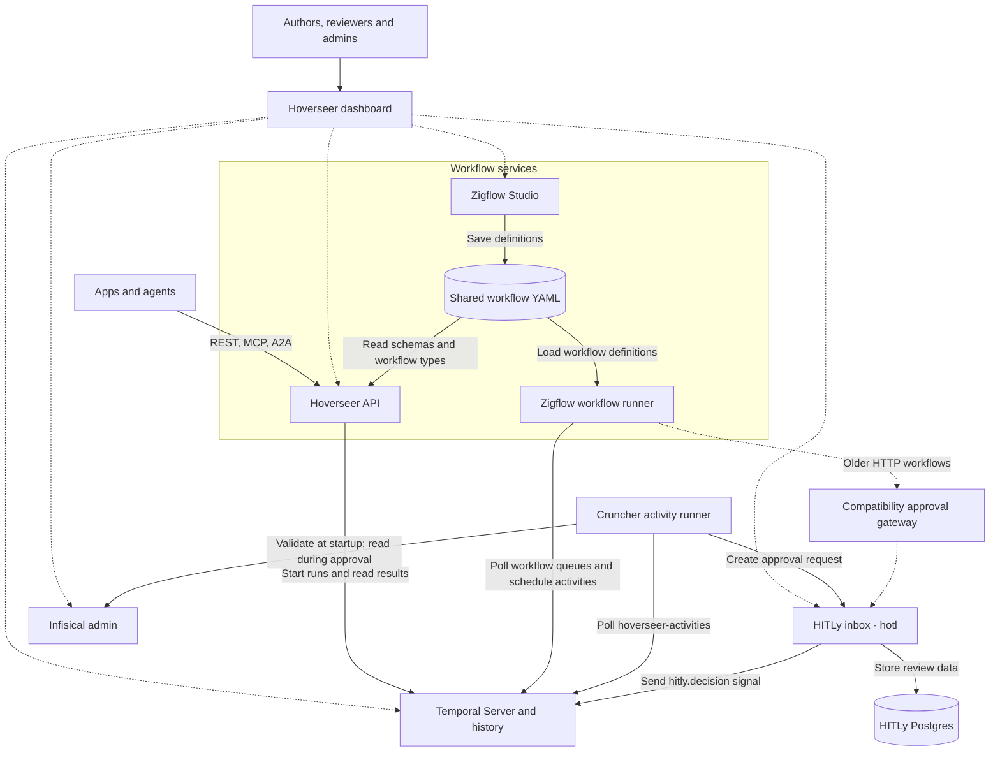
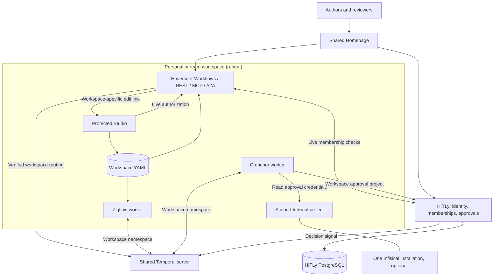

# Architecture

How Hoverseer's services fit together, and where things live in the repository. Back to the [README](../README.md).

## Services

| Container | Type | Purpose |
| --- | --- | --- |
| `dashboard` | Management dashboard | Homepage launchpad for Studio, HITLy, Temporal Web, OpenAPI and Infisical on `8082`. |
| `api` | API server | Exposes managed workflows through REST, MCP, A2A, and OpenAPI on `8081`. |
| `studio` | Authoring server | Edits the shared Zigflow YAML on `3000`. |
| `temporal` | Orchestration server | Persists workflow history, timers, and signals. Serves Temporal clients on `7233` and Temporal Web on `8233`. |
| `hotl` | Review server | Runs the HITLy inbox on `3001` and sends reviewer decisions to Temporal. |
| `postgres` | Database server | Stores HITLy inbox and project data. |
| `zigflow` | Workflow runner | Loads the YAML and polls the workflow task queues. Handles control flow and approval waits. |
| `cruncher` | Activity runner | Runs HITLy approval and shell steps. Polls the shared `hoverseer-activities` queue. |
| `approval-gateway` | Compatibility server | Accepts approval requests from older saved workflows that still use HTTP. |

Docker Compose runs nine long-running containers during migration and eight after the compatibility gateway is retired. On Kubernetes, API, Studio and Zigflow share the `workflow` pod and YAML volume. The dashboard, Cruncher, Temporal, HITLy, Postgres and compatibility gateway each have their own deployment. Infisical runs separately if enabled.

## Workspace mode

The Docker Compose overlay retains one shared Homepage, HITLy, API and Temporal server. It adds a fixed Studio, YAML directory, Zigflow worker and Cruncher worker per configured workspace. Optional Infisical projects and read-only machine identities are independent. Temporal namespaces are routing and history boundaries, not a sandbox.

### Operational boundaries

- The reference multiuser deployment is Docker Compose; Kubernetes remains single-environment.
- Each mapped workspace shares the public catalog aliases and input schemas, but can change the YAML implementation. A managed run belongs to the initiating user even in a shared workspace.
- Saving YAML is not deployment. Finish active executions; an administrator runs `./hoverseer docker reload workspace-a` to check catalog compatibility, validate the selected YAML files, then restart its worker and the API. A rejected preflight does not restart either service. Invalid files still need repair before a cold startup.
- The workspace overlay removes published raw Temporal Web and the legacy Studio port. Host administrators retain Docker access, including Temporal CLI commands. Do not publish raw services or give untrusted users Docker access.
- HITLy and Infisical permissions are administered separately. Removing a HITLy membership denies new API and Studio requests, but does not revoke Infisical accounts or cancel already-running workflows. Administrators must manage both systems.
- Shell activities run with the worker's OS identity and network. Namespace separation and scoped credentials do not protect against malicious workflow authors.

The cumulative full-stack test and its screenshots are published in GitHub Actions under `smoke-diagnostics`. It exercises the original deployment and the workspace and Infisical overlays in one disposable stack.

## Repository layout

| Path | Contents |
| --- | --- |
| `api/` | REST, MCP and A2A workflow endpoints |
| `cruncher/` | Temporal activity worker startup and credentials |
| `nodes/` | Shared Studio definitions, activity handlers, tests and YAML examples |
| `gateway/` | Compatibility gateway for older approval workflows |
| `integrations/` | Integration clients shared by services |
| `workflows/` | Bundled workflows and their public catalog |
| `deploy/` | Dockerfiles, Kubernetes manifests, dashboard settings and workflow seeding |

The root `compose.yaml`, `kustomization.yaml` and `./hoverseer` are deployment entry points. Kustomize resolves the workflow files and shared source from the repository root.
